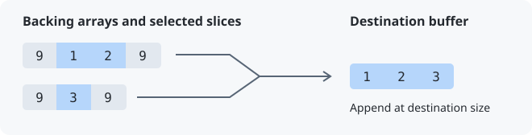

# Byte strings and builders

Use `ByteString` when you need a contiguous sequence with cheap slicing.
`take`, `drop`, and `splitAt` share the backing `ByteArray`; use `copy` if a
small slice should not retain its original backing array.

Use `LazyByteString` to consume strict chunks without flattening them.
`Builder` composes producers without copying their bytes at composition
time. It still has per-chunk overhead, especially for `word8`.

`ByteString.concat` advances one destination buffer with `ByteArray.copySlice`.
The compiled runtime grows it geometrically, avoiding a copy of the entire
prefix on each chunk. `ByteString.intercalate`, `LazyByteString.toStrict` and
`Builder.toStrictByteString` reuse that path. Repeatedly calling strict
`append` on a growing value still copies; use `concat` when the pieces are
already available. These are implementation properties, not throughput
benchmarks.
