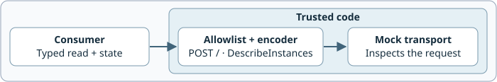

# Cookbook: a read-only operation over HTTP POST

AWS EC2 Query can carry `DescribeInstances` (a read) and `TerminateInstances`
(a write) as `POST /` requests to the same endpoint. The form's `Action` field
selects the operation, so allowing the method and URL alone would allow both.
Use Linen's `OperationPolicy` to allow the read without exposing raw POST.

This example uses the EC2 Query request shape with a placeholder host under
`.test`. It does not contact AWS or use credentials.



## Define the operations and encode the read

```lean
import Linen.Control.Monad.Effect.HTTP

open Control.Monad.Effect Control.Monad.Effect.HTTP
open Network.HTTP.Client (Response)
open Network.HTTP.Types (hContentType status200)

/-- EC2 Query operations in this example; only the describe is granted. -/
private inductive Ec2Op where
  | describeInstances | terminateInstances

/-- Filter values this consumer is allowed to send. -/
private inductive InstanceState where
  | running | stopped

/-- The read takes a state filter; the denied write would take an instance ID. -/
private def Ec2Input : Ec2Op → Type
  | .describeInstances => InstanceState
  | .terminateInstances => String

private abbrev ec2Url : Url := u!"https://ec2.example.test/"
private abbrev ec2Transport : Capability :=
  { canPost := true, scopes := [under ec2Url [.POST]] }

/-- Encode the action and endpoint in the policy, not in the caller's input. -/
private def ec2Reads : OperationPolicy ec2Transport Ec2Op Ec2Input where
  allows
    | .describeInstances => true
    | .terminateInstances => false
  encode
    | .describeInstances, _, state =>
      let stateValue := match state with
        | .running => "running"
        | .stopped => "stopped"
      let body := "Action=DescribeInstances&Version=2016-11-15" ++
        "&Filter.1.Name=instance-state-name&Filter.1.Value.1=" ++ stateValue
      .request .POST rfl ec2Url (by decide)
        [(hContentType, "application/x-www-form-urlencoded")] [] (some body.toUTF8)
    | .terminateInstances, denied, _ => nomatch denied

/-- Consumer code gets the operation effect, not the raw transport effect. -/
private def describeInstances (state : InstanceState) : Eff [OperationHTTP ec2Reads] Response :=
  callOperation ec2Reads .describeInstances state

example : ec2Reads.allows .terminateInstances ≠ true := by decide
```

The capability permits POST within its URL scope. The encoder is what fixes the
exact path `/`, the `DescribeInstances` action, and the form content type.
The caller can supply only a state enum; the encoder maps it to a fixed form
value. There is no raw form, query, or header input to override the action.
`callOperation` and the underlying effect constructor both require proof that
the selected operation is allowed. The last line proves there is no such proof
for `TerminateInstances`.

## Run against a mock transport

Append this to the example:

```lean
#eval show IO Unit from do
  let _ ← runOperationHTTPWith ec2Reads (fun req => do
    let body := req.body.bind String.fromUTF8?
    IO.println s!"{req.method} {req.path} {body.getD ""}"
    pure { statusCode := status200, headers := [], body := ByteArray.empty })
    (describeInstances .running)
  pure ()
```

It prints:

```text
POST / Action=DescribeInstances&Version=2016-11-15&Filter.1.Name=instance-state-name&Filter.1.Value.1=running
```

Keep the encoder and transport in trusted code. Give the consumer only
`OperationHTTP ec2Reads` for HTTP access: if it also gets `HTTP ec2Transport`,
it can submit its own body to the same POST endpoint without going through the
allowlist. Other raw network access would bypass the policy too. Linen checks
the policy's evidence; it does not classify EC2 actions, check what a supplied
transport sends, or replace provider-side authorization.

See the [HTTP capability contract](../Linen/Control/Monad/Effect/HTTP/SPEC.md)
and the [offline regression](../LinenTest/Linen/Control/Monad/Effect/HTTPTest.lean).
