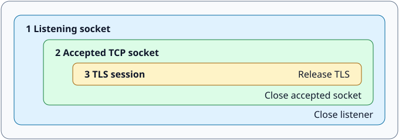

# Scoped resource lifecycles

A scoped program describes the operations on a resource that Linen acquires
and owns for one run. Its type records the state it starts in and the state
available on success. Each resource module exports its own operations and
runner. The runner keeps the native handle to itself. You can store an action
as a value and run that action again on a newly acquired resource.



## Compose actions

For fixed transitions, use `Control.Resource.Program.ibind`. In the example
below, the first continuation must start connected and the second must close
that connection before the result can leave the socket runner.

```lean
import Linen.Network.Socket.Scoped

open Control.Resource Network.Socket

def sendRequest (address : SockAddr) (request : ByteArray) : IO Unit :=
  SocketM.run .inet .stream <|
    Program.ibind (SocketM.connect address) fun () =>
    Program.ibind (SocketM.sendAll request) fun () =>
    SocketM.close
```

Use ordinary `do` notation for operations that keep a state unchanged. For
instance, you can group `SocketM.sendAll` and `SocketM.recvBlocking` together
in a `.connected` block, then sequence it with `SocketM.close` using
`Program.ibind`. `Program.map` carries a value across a fixed transition, so
`Program.map (fun () => bytes) SocketM.close` closes and returns `bytes`.

Use `Program.bind` when the result selects the next state. After
`SocketM.connectNB`, pattern match on `.connected` and `.inProgress`. The
first branch can immediately send. The second can poll for writability and
call `SocketM.connectFinish`, which can still report `.inProgress`.
A refused connection throws and the bracket closes the socket. The same
dependent bind lets you read SQLite columns in the `.row` branch of a
statement step. The `.done` branch can reset or finalize the statement.

`SocketM.recvOrClose` applies the same pattern to events from a peer.
`Program.bind` gives the data and backpressure handlers a connected
socket. On EOF or error, the operation closes the socket and the handler
starts closed. Choose `SocketM.recv` if your protocol writes after the
peer has finished sending or needs its own error recovery. This adapts
the result-dependent receive in the [Idris socket example](https://docs.idris-lang.org/en/latest/st/examples.html).

## Pick the boundary

| Import | Runner or boundary | Lifecycle |
| --- | --- | --- |
| `Linen.Network.Socket.Scoped` | `SocketM.run`, `SocketM.withAccepted` | Fresh, bound, listening, connecting and connected sockets. Accepted connections are nested. Successful programs close explicitly. |
| `Linen.Network.TLS.Scoped` | `TLSM.runClient`, `TLSM.runServer` | Programs start after a successful handshake. Session shutdown precedes outer socket cleanup when composed through `SocketM`. |
| `Linen.Network.HTTP.Client.Scoped` | `ExchangeM.run` | One HTTP/1.1 exchange sends before receiving and closes the transport on exit. HTTP.Simple uses this runner. |
| `Linen.Network.WebSockets.Scoped` | `WebSocketM.runClient`, `WebSocketM.runTransport` | Sending a close frame moves to closing. Receiving a peer close frame moves to closed. The transport owner shuts down the underlying connection. |
| `Linen.Database.SQLite.Scoped` | `ConnectionM.run`, `ConnectionM.withStatement` | Close a connection or finalize a cursor. Only a current row exposes column values. |
| `Linen.Database.DuckDB.Scoped` | `ConnectionM.run`, `ConnectionM.withAppender`, `ConnectionM.withFile` | Connections own nested bulk appenders and file handles. Append one complete row at a time. |
| `Linen.Database.SQL.Scoped` | `ConnectionM.run`, `PoolM.run` | Typed statements run without exposing the managed PostgreSQL handle. A borrowed pool connection is returned before the next action. |
| `Linen.Database.Redis.Scoped` | `ConnectionM.run`, `ConnectionM.runTLS` | Send requests and return decoded replies before closing the owned pool. |
| `Linen.System.Worker` | `WorkerM.run` | A stopped worker cannot accept another call. A failed request aborts the program and the owner reaps the process. |
| `Linen.Network.WebApp` | `Application` | The server interprets a response program that starts pending and ends sent. Existing framework middleware can use its explicit escape hatch. |

The single-phase runners built on `Owned` also release on normal return if
the program leaves the resource open. `ResourceT` remains useful when the
number of resources is determined at runtime and a common scope should
release them in reverse order. It still exposes the acquired values, so
consumers must coordinate how those values are used.

The scoped interfaces preserve the existing direct APIs for applications
that share or transfer handles across tasks. HTTP/2 connection and stream
state, event dispatcher registrations, timeout expiry and pool internals
receive events from other actors. Those implementations still decide
readiness, expiry and cancellation at runtime. C bindings continue to expose
native statuses and their own ownership rules. QUIC's transport is stubbed.

An index can guarantee an invariant while the interpreter controls that
part of the resource. Exclusive ownership prevents another local caller
from closing the socket. A peer can still reset the connection after a
successful connect. If another actor can invalidate a prerequisite, check
it at the operation boundary and represent the outcome in the API.
An earlier observation can become stale before the next call.
For example, nested SQL transaction statements and transaction control
issued as raw SQL are checked by the database. The scoped connection APIs
do not parse SQL or RESP commands. TLS sessions rely on a live transport.
WebSocket receive uses the existing framing implementation's close
observation.

## Implement a runner

Use `ProgramT m access world pre α post` where `world state` holds the
interpreter's data for that state and `post : α → stateType` selects its
state on success. Keep the proof of `access` private and opaque to consumer
modules. Use `ProgramT.step` where native operations implement the indexed
transition, and `ProgramT.run` only at the interpretation boundary. Keep
handles out of results, callbacks and lifted actions. Use `Owned` for
open/closed resources with a terminal release operation, or a bracket
around the runner for a wider state machine.

This design adapts Idris's result-dependent `STrans` and uses separate,
nested scopes for resources with different lifetimes. Idris additionally
tracks named resources in a heterogeneous resource list. Linen's runner
models a resource by its indexed world and offers nested interpreters
where a parent API owns a child. See the [Idris ST tutorial](https://docs.idris-lang.org/en/latest/st/state.html)
and [Control.ST source](https://github.com/idris-lang/Idris-dev/blob/master/libs/contrib/Control/ST.idr).
